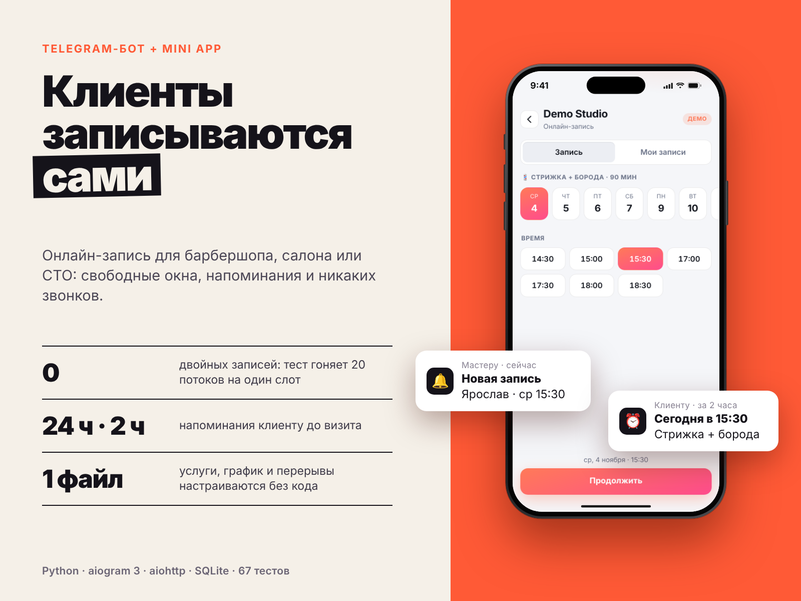
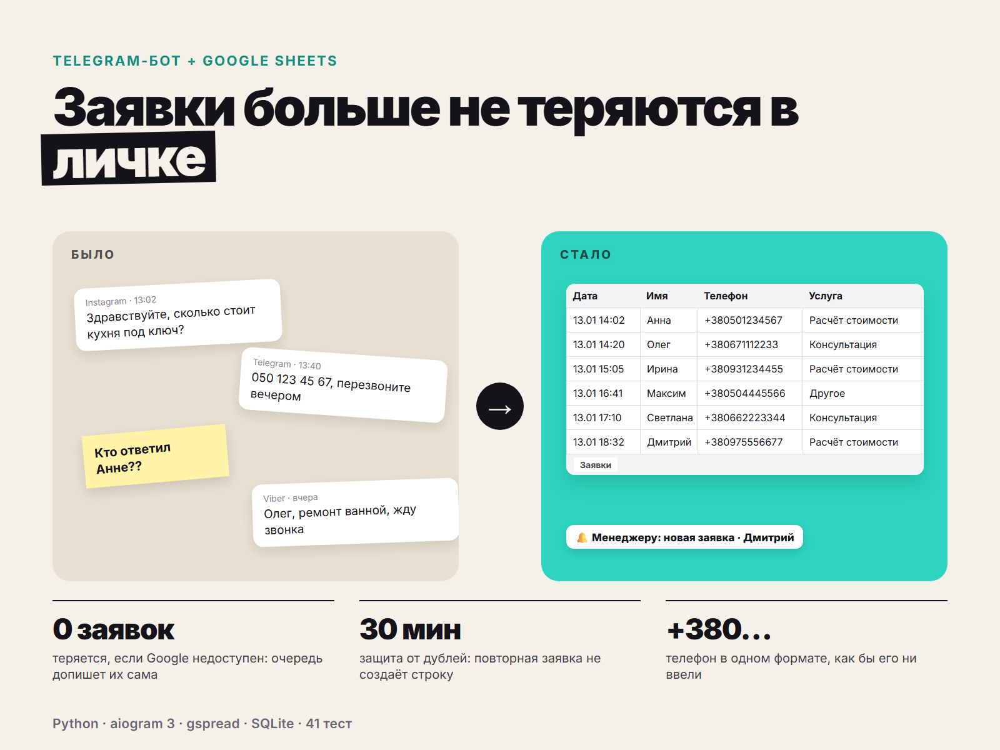
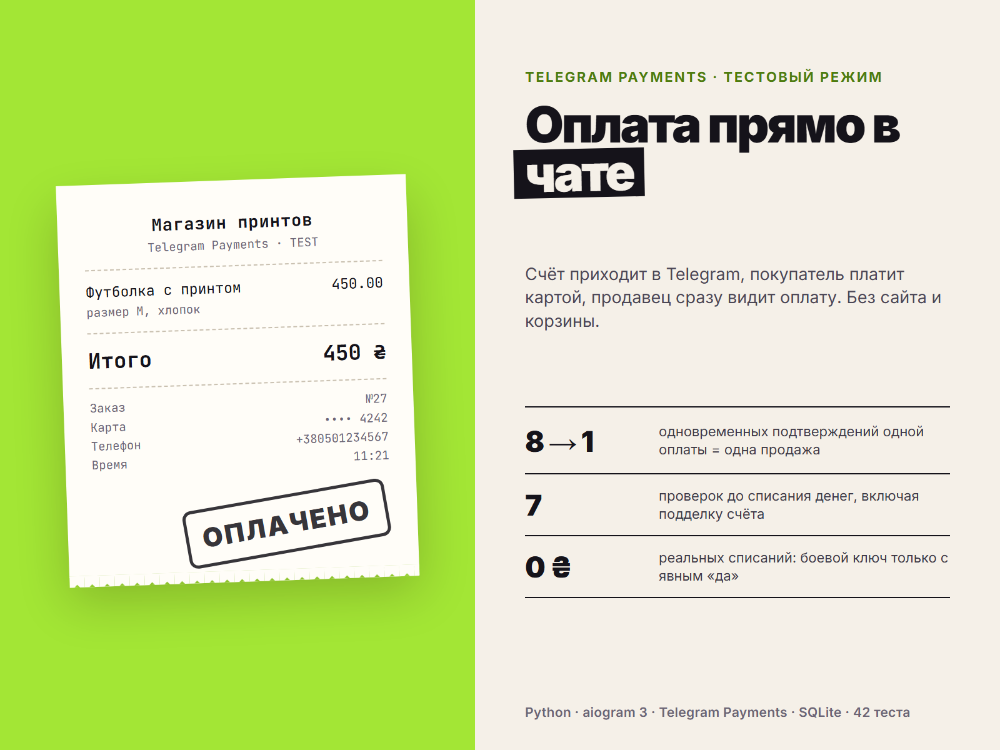
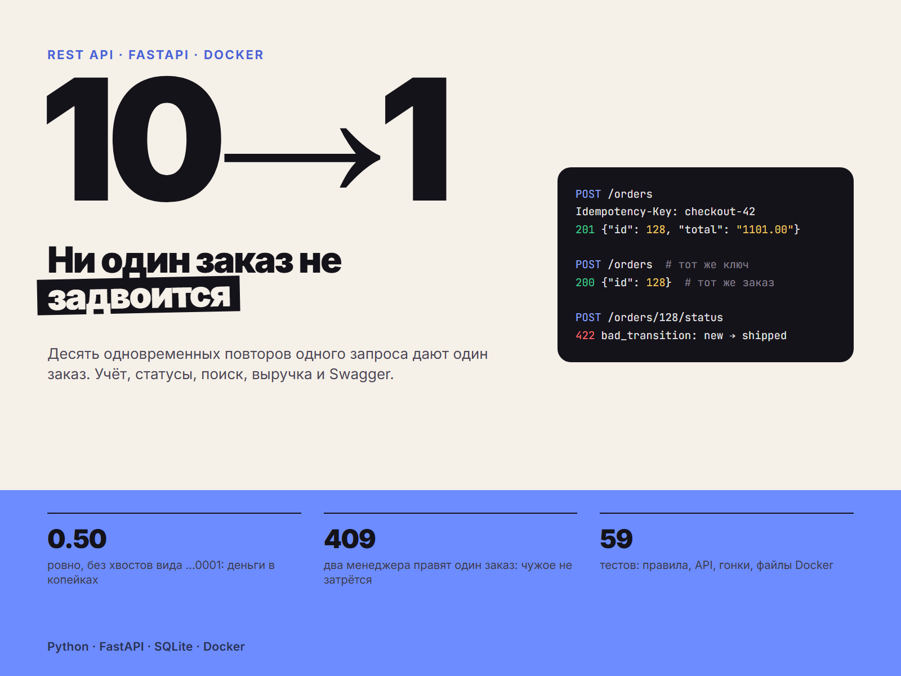
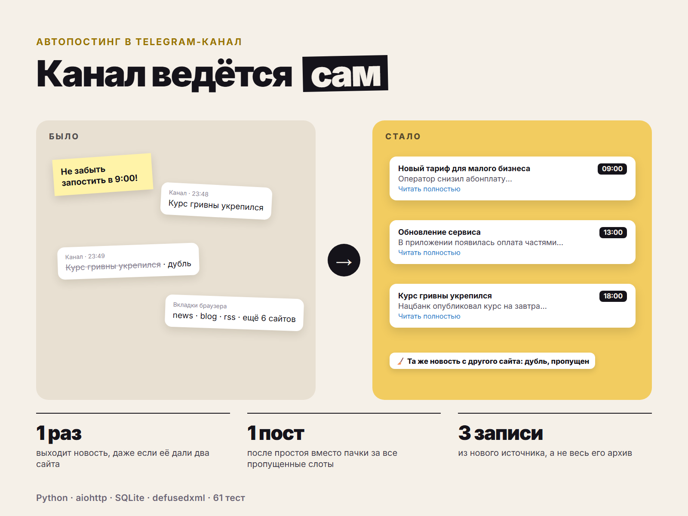
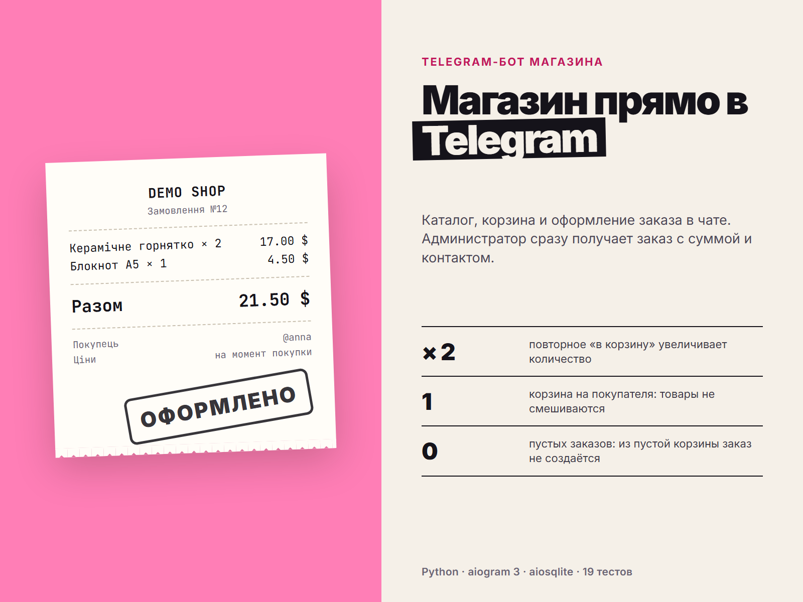
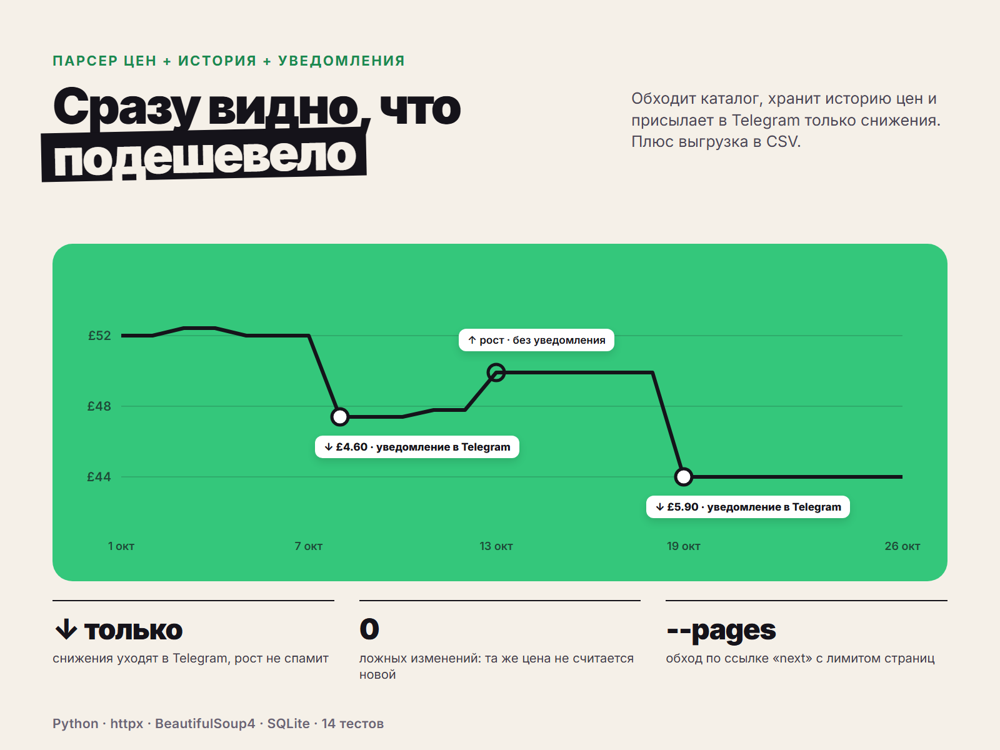
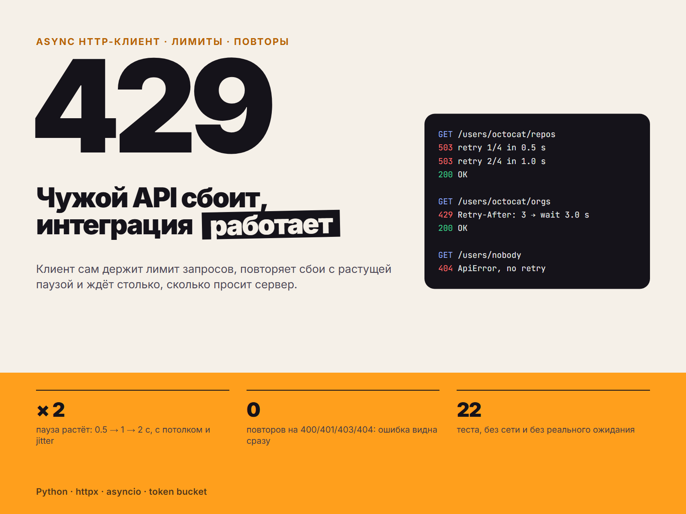
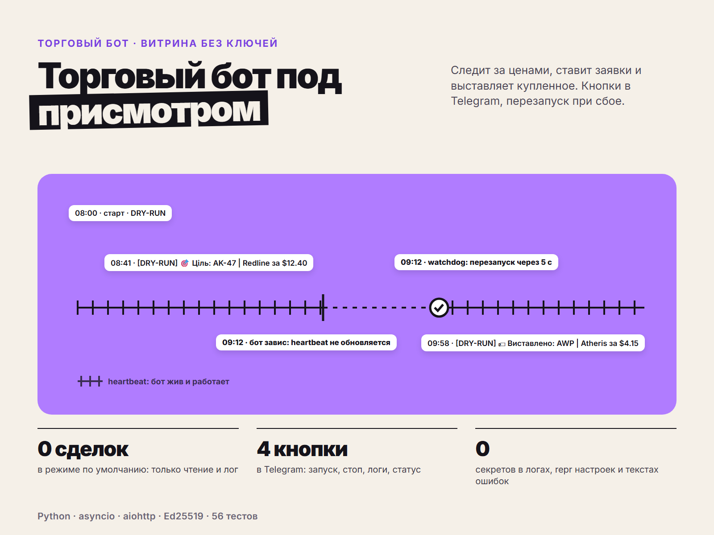

**Yaroslav Pushkov (Juprak)**, Kharkiv, Ukraine. Python developer: Telegram bots, parsers, API integrations, small backend services.

Українською: Python-розробник з Харкова. Telegram-боти, парсери, інтеграції з API та невеликі бекенд-сервіси.

**Stack:** Python · asyncio · aiogram 3 · aiohttp · FastAPI · httpx · SQLite · Docker · pytest

Every project below has tests, a README with setup steps, and no keys in the code.

| | Project | What it does |
|---|---|---|
|  | [telegram-booking-bot](https://github.com/YappySd/telegram-booking-bot) | Online booking bot + Telegram Mini App: free slots, reminders, no double bookings. 75 tests |
|  | [sheets-lead-bot](https://github.com/YappySd/sheets-lead-bot) | Lead form in Telegram → Google Sheets row + manager notification; leads are queued if Google is down. 41 tests |
|  | [payments-demo-bot](https://github.com/YappySd/payments-demo-bot) | Payments inside a Telegram bot (Telegram Payments, provider test mode), pre-checkout checks, no double counting. 42 tests |
|  | [orders-api](https://github.com/YappySd/orders-api) | FastAPI order service: statuses, search, revenue, idempotent creation, Docker. 59 tests |
|  | [channel-autoposter](https://github.com/YappySd/channel-autoposter) | RSS/websites → Telegram channel on schedule, duplicate protection. 61 tests |
|  | [telegram-shop-bot](https://github.com/YappySd/telegram-shop-bot) | Shop bot: catalog, cart, checkout, admin notifications. 19 tests |
|  | [price-tracker](https://github.com/YappySd/price-tracker) | Price parser with history, CSV export and Telegram alerts on price drops. 14 tests |
|  | [resilient-api-client](https://github.com/YappySd/resilient-api-client) | Async HTTP client: rate limit, retries with backoff, Retry-After. 22 tests |
|  | [marketplace-trading-bot](https://github.com/YappySd/marketplace-trading-bot) | Showcase of a marketplace trading bot: signed API, dry-run by default, Telegram panel, watchdog. 56 tests |

**Contact:** Telegram [@welldonechief](https://t.me/welldonechief)
